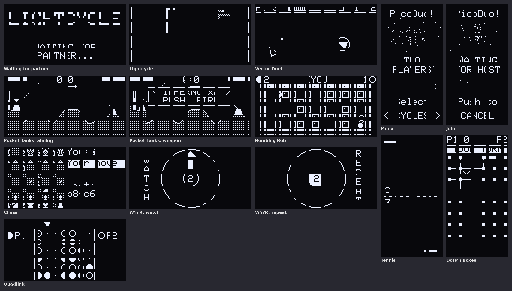

# PicoBoy Duo – PicoPac plus Zweispieler über USB-C

Firmware für den **alten PicoBoy** (RP2040, 128×64-OLED, schwarz-weiß), gebaut
mit dem Pico SDK. Sie vereint die Einzelspieler-Sammlung **PicoPac**
(unverändert in Aussehen und Spiel) mit zehn Zweispieler-Spielen für zwei
PicoBoys, die über ein USB-C-Kabel verbunden sind (Umsetzung der
[i2collection](https://github.com/hcl1981/pbc-plus/tree/main/i2collection) des
PicoBoy Color Plus, dazu Jump 'n Bump als **POPBIT**).

```bash
./build.sh          # -> dist/pbduo.uf2 (fertige Datei auch als ./pbduo.uf2)
```

Flashen: Beim Einstecken BOOTSEL halten, dann `pbduo.uf2` auf das Laufwerk
`RPI-RP2` kopieren. **Beide Geräte bekommen dieselbe Firmware.**



## Hauptmenü

Das Sternenfeld-Menü von PicoPac (hochkant, Highscores, LED-Lauflicht),
Links/Rechts blättert, Mitte wählt:

1. PICTRIS  2. SCLANGE  3. TABMAN  4. W'n'R  5. Memor – wie in PicoPac
6. **MULTI** – die Zweispieler-Spiele
7. Demo
8. **Settings** – Links/Rechts wählt, Mitte ändert, BACK speichert:
   * **Sound** an/aus
   * **Display**: Helligkeit in 5 Stufen (Standard = Stufe 3 wie PicoPac;
     heller kostet Knopfzellenstrom), auch mit Hoch/Runter
   * **Scores**: alle Highscores löschen, nach Rückfrage (NO vorausgewählt)
   * **Info**: Lizenzhinweise, Hoch/Runter blättert

Conway und HWTest sind entfallen. Die Einzelspieler-Spiele laufen wie im
Original bis zum Ausschalten; die Highscores liegen an derselben Flash-Stelle
wie bei der Originalfirmware und bleiben beim Umflashen erhalten.
Langes Halten der Mitte-Taste hat nirgends eine Sonderfunktion.

## MULTI

Gleicher Aufbau und gleiche Schrift wie das Hauptmenü: oben „MULTI“, wo dort
die Highscores stehen „CONNECT USB CABLE“. Links/Rechts blättert, Mitte wählt:

* ein **Spiel** wählen → dieses Gerät bietet es an (Host)
* **BACK** → zurück ins Hauptmenü

Eine Rolle muss man nicht wählen: Solange ein Gerät im Hauptmenü oder in MULTI
steht, lauscht es auf die Gegenseite. Wählt das andere Gerät ein Spiel, springt es automatisch
mit hinein. Wählen beide gleichzeitig ein Spiel, merken sie das und eines
weicht aus – beide landen im selben Spiel.

Der Startbildschirm eines Spiels zeigt nur den Namen und entweder
„WAITING FOR PARTNER" oder „PUSH!" – Mitte startet. Beim Host bricht Links ab.

## Die Spiele

| Spiel (Menü) | Lage | Steuerung | Anpassung an 128×64 s/w |
|---|---|---|---|
| LIGHTCYCLE (CYCLES) | quer | Steuerkreuz | Feld 62×30; P2-Spur gerastert |
| TENNIS | hochkant | Links/Rechts | eigener Schläger unten |
| VECTOR DUEL (DUEL) | quer | L/R drehen, Hoch Schub, Runter Schild, Mitte Feuer | P1 Umriss, P2 gefüllt |
| POCKET TANKS (TANKS) | quer | L/R Winkel, H/R Kraft; Mitte → Waffe wählen (L/R), Mitte → Feuer, H/R zurück | Höhenkarte; Winkel als gestrichelte Rohrverlängerung, Kraft als schmaler Balken, Waffe nur bei der Auswahl |
| BOMBING BOB | quer | Steuerkreuz, Mitte Bombe | Feld 15×7; Mauern voll, Ziegel als leere Kästchen |
| CHESS | quer | Steuerkreuz, Mitte wählen/ziehen | eigene 7×7-Figuren; Weiß gefüllt, Schwarz Umriss |
| W'N'R | quer | Steuerkreuz | Grafik wie W'n'R der PicoPac-Sammlung (WATCH / REPEAT / ADD) |
| QUADLINK | quer | L/R Spalte, Mitte einwerfen | Einwurfpfeil nur bei eigenem Zug; Gewinnreihe blinkt |
| DOTS'N'BOXES (DOTS) | hochkant | Steuerkreuz wählt einen Punkt, Mitte hält ihn fest, Richtung zieht den Strich (nochmal Mitte: abbrechen) | P1-Kästchen gefüllt, P2 gekreuzt |
| POPBIT | quer | L/R laufen, Hoch oder Mitte springen | Jump 'n Bump, siehe `jumpnbump/README.md` |

Der alte PicoBoy hat keine A/B-Tasten; überall übernimmt **Mitte** deren
Aufgabe. Nach Spielende geht es für beide zurück in die MULTI-Liste.

## Verbinden

1. Beide Geräte mit einem USB-C-Kabel verbinden. Wie beim PBC+ gilt:
   **D+, D− und GND verbinden, VBUS nicht** – beide Geräte laufen auf ihrer
   Knopfzelle, der USB-Anschluss ist ja belegt.
2. Ein Gerät wählt unter MULTI ein Spiel; das andere steigt von selbst ein,
   wenn es im Hauptmenü oder in MULTI steht (nicht aus einem laufenden
   Einzelspieler-Spiel heraus).
3. Beide drücken auf dem Startbildschirm Mitte.

Reißt die Verbindung ab, hält das Spiel an und zeigt „LINK LOST / CHECK
CABLE"; die rote LED leuchtet. Steckt das Kabel wieder, geht es weiter.

Kommt keine Verbindung zustande, liegt es meist am Kabel (viele USB-C-Kabel
sind reine Ladekabel ohne D+/D−) – alle vier Steckerorientierungen probieren.

## Wie die Verbindung funktioniert

Kein USB-Protokoll: der RP2040 kann seine USB-Leitungen per
`USBPHY_DIRECT`-Override direkt als Ein-/Ausgänge benutzen (die Register sind
bitgleich zum RP2350). Darauf läuft derselbe getaktete Halbduplex-Link wie beim
D+/D−-Link der PBC+-Projekte:

```
D−  = CLK    treibt nur der Host
D+  = DATA   Halbduplex
```

Beide Seiten arbeiten im Timer-Interrupt; die Spiele merken davon nichts. Der
Host rechnet das ganze Spiel und schickt alle ~15 ms den vollständigen
Zustand, der Gast schickt seine Tasten (als Druckzähler, damit kein kurzer
Druck verloren geht). Die zeitkritischen Bitschleifen liegen im RAM.

Gegenüber der i2collection entfallen damit TinyUSB, der Host-Modus, die
Treiber-Patches und die Neu-Enumeration.

| Datei | Inhalt |
|---|---|
| `src/main.cpp` | Hauptmenü (PicoPac) → Einzelspieler-Spiel oder MULTI |
| `src/multi.*` | MULTI-Liste |
| `src/settings.*` | Einstellungen (EEPROM ab Adresse 16) |
| `src/starscreen.*` | Menü-Aufbau wie PicoPac für MULTI und Settings |
| `picopac/` | Quellen der PicoPac-Sammlung (siehe `picopac/README.md`) |
| `src/picopac/` | dünne Arduino-/U8g2-Hülle aufs Pico SDK, EEPROM im Flash |
| `third_party/u8g2/` | U8g2-C-Bibliothek (BSD-2) mit den benötigten Schriften |
| `jumpnbump/src/` | POPBIT (Jump 'n Bump) |
| `src/link.*` | D+/D−-Link (Bitebene, Timer-Interrupts) |
| `src/play.*` | Sitzung: Paketkopf, Pause, Startbildschirm |
| `src/gfx.*`, `src/hw.*` | SH1106-Display, Tasten, Ton, LEDs |
| `src/games/*.cpp` | die neun i2collection-Spiele, `table.cpp` = Spieleliste |
| `tools/sim/` | PC-Simulator (siehe unten) |

## Simulator

`tools/sim` baut die echten Spiel- und Grafikquellen für den PC. Host und Gast
laufen als zwei Prozesse, verbunden über einen Socket statt des Kabels;
Tasten kommen aus einem Zufallsskript, das Display ist ein nachgebildeter
SH1106. Beide Bildschirme werden als PGM gespeichert. Mit AddressSanitizer.

```bash
tools/sim/build.sh
tools/sim/pbsim <spiel 0..9> <sekunden> <ordner> [ms zwischen Bildern] [seed]
tools/sim/pbsim -1 <sekunden> <ordner>     # ganze Firmware, ein Geraet
tools/sim/pbsim -2 <sekunden> <ordner>     # ganze Firmware auf beiden Geraeten
```

Statt Zufallseingaben lassen sich feste Tastenfolgen vorgeben:
`PBSIM_KEYS_HOST` / `PBSIM_KEYS_GUEST`, ab 5 s alle 300 ms ein Zeichen
(`U D L R C`, `.` = nichts, `*` am Ende = wiederholen). `PBSIM_RAW=1`
speichert den Displayspeicher ungedreht (für Spiele, die selbst drehen).

Der Simulator prüft Spiellogik, Synchronisation und Bildaufbau – **nicht** die
Elektrik und das Timing des Kabel-Links.

## Stand

Gebaut und im Simulator geprüft. **Auf echter Hardware noch nicht getestet**,
insbesondere der D+/D−-Link auf dem RP2040 bei 50 MHz (die
Originalsoftware des PicoBoy läuft mit 50 MHz; das schont die Knopfzelle).


## Lizenz

Die eigenen Teile von PicoBoy Duo stehen unter MIT (`LICENSE`), die
5×7-Schrift stammt aus der Adafruit-GFX-Library (BSD, `LICENSE-Adafruit-GFX.txt`),
U8g2 steht unter BSD-2 (`third_party/u8g2/LICENSE`). Weil POPBIT (Jump 'n Bump)
unter der **GPL v2+** steht (`jumpnbump/LICENSE`), ist die fertige Firmware als
Ganzes unter der GPL weiterzugeben. Die PicoPac-Quellen stammen aus
[hcl1981/picoboy](https://github.com/hcl1981/picoboy); das Repository enthält
keine Lizenzdatei.
