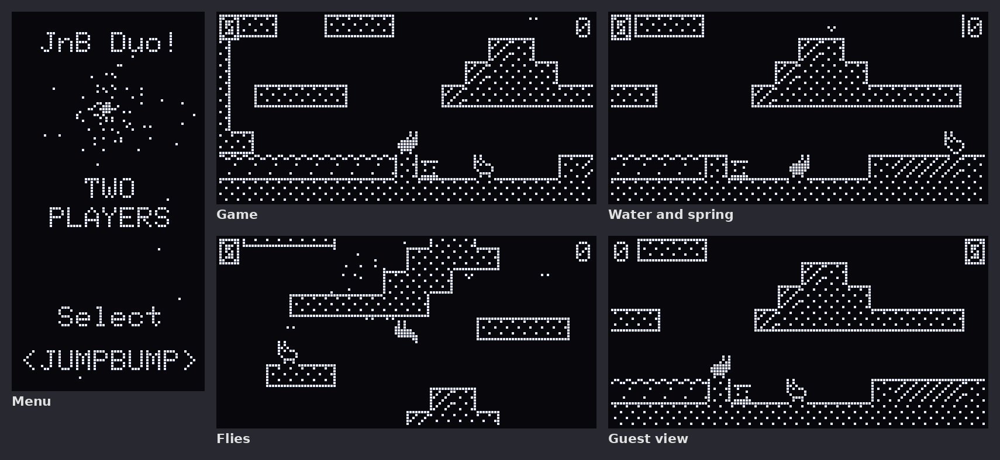
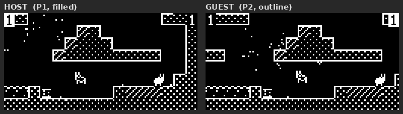

# POPBIT – Jump 'n Bump für zwei (alte) PicoBoys

Teil von PicoBoy Duo (Eintrag **POPBIT** unter MULTI); benutzt Link und
Sitzungsrahmen aus `../src`. Umsetzung der PBC+-Fassung aus `jnb/jumpnbump`
auf 128×64 schwarzweiß. Gebaut wird es mit der Hauptfirmware (`../build.sh`).

(20 s aus dem Simulator, beide Geräte nebeneinander; die Hasen werden dort
von Zufallseingaben gesteuert.)

## Spielen

Ein Gerät wählt unter MULTI **POPBIT**, das andere steigt aus dem Hauptmenü
oder aus MULTI von selbst ein; beide drücken Mitte.

| Taste | Wirkung |
|---|---|
| Links / Rechts | laufen |
| Hoch oder Mitte | springen (loslassen bricht den Sprung ab) |
| Mitte nach Spielende | neue Runde |

Getroffen wird, wer von oben zerquetscht wird. Ziel sind wie im Original
100 Treffer; danach geht es zurück in die MULTI-Liste. Hase 1 (Host) ist
gefüllt, Hase 2 (Gast) ein Umriss; der eigene Punktestand steht invertiert.

## Was übernommen ist

`src/game.cpp` ist die Mechanik der PBC+-Fassung, die sie 1:1 aus `main.c` des
Originals hat: Festkommaphysik mit den Originalkonstanten, 60-Hz-Takt, Eis,
Wasser mit Auftrieb, Sprungfeder, Zerquetschen und seitliches Abprallen,
Wiedereinstieg, Fell und Fleisch mit Blutspur und dauerhaften Blutflecken,
Fliegenschwarm und Schmetterlinge. Geändert sind nur die Anbindungen.

## Was anders ist

* **Bild:** Das Level (352×256) wird in halber Auflösung aus der Kachelkarte
  gezeichnet (176×128, Kacheln 8×8); das Display zeigt 128×64 davon und
  scrollt auf den eigenen Hasen. Feste Blöcke punktiert mit Kanten, Eis
  schraffiert, Wasser bewegt. Die Originalgrafik (Farbbild, Sprites) passt
  nicht auf 128×64 s/w; Hasen sind eigene 8×8-Bilder, Fell, Fleisch, Rauch,
  Fliegen und Falter einzelne Pixel.
* **Ton:** keine Musik und keine Klangdateien, nur kurze Piepser (Sprung,
  Feder, Wasser, Tod).
* **Link:** der D+/D−-Link von PicoBoy Duo statt TinyUSB. Der Host rechnet die
  Mechanik und schickt je Austausch 22 Byte: Positionen, Bildnummern,
  Zustandsbits, Todes- und Ereigniszähler. Schmückendes läuft auf beiden
  Geräten lokal. Zähler statt Ereignisbits, weil nicht jedes Bild einen
  Austausch bekommt.

## Lizenz

Jump 'n Bump steht unter der GPL v2+ (`LICENSE`). Da POPBIT in der
Firmware steckt, ist `pbduo.uf2` als Ganzes unter der GPL weiterzugeben.

## Simulator

`../tools/sim/pbsim 9 <sekunden> <ordner>` – Host und Gast als zwei Prozesse.

## Stand

Im Simulator geprüft, auf den Geräten noch nicht getestet.

Jump 'n Bump (C) 1998 Brainchild Design, GPL2+; Portierungen: Chuck Mason,
Florian Schulze, Côme Chilliet u. a.
